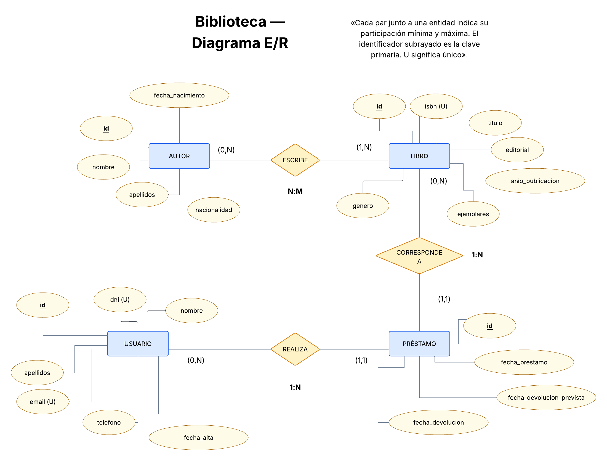
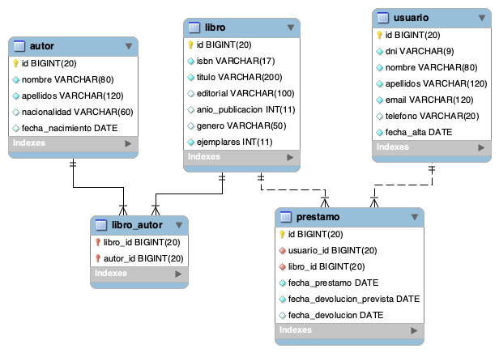
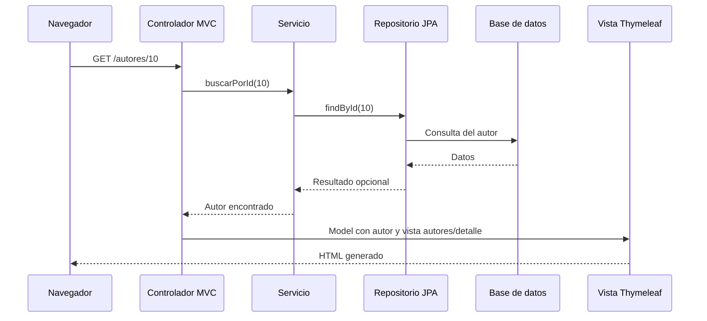

# Informe técnico de Jacobo: autores, usuarios y diagramas

**Proyecto:** Biblioteca · FP.449 / FP065 · Producto 2: Primer MVC

**Responsable de esta parte:** Jacobo Barrera Toba

**Fecha de revisión:** 24 de octubre de 2026

**Rama:** `feature/jacobo-autores-usuarios`

**Estado:** implementación obligatoria terminada, 43 tests correctos y revisión en navegador con MariaDB realizada. Pendiente de abrir la PR del código hacia `develop` y de revisión por Erick.

Este documento recoge la aportación de Jacobo y sirve de apoyo para la revisión y para redactar la memoria del equipo. Describe la implementación existente; la memoria y el vídeo de la entrega se montan posteriormente con la versión final del proyecto.

## 1. Resumen de la aportación

Se han realizado dos bloques de trabajo:

1. **Documentación del modelo de datos:** diagrama entidad-relación conceptual en Lucidchart y modelo relacional obtenido de MariaDB mediante ingeniería inversa con MySQL Workbench. Los diagramas se incorporaron al repositorio el 13 de octubre y ya están integrados en `develop` mediante la PR #2.
2. **Consulta de autores y usuarios:** servicios, controladores MVC, cuatro vistas Thymeleaf y seis pruebas de integración. Permiten consultar los autores y sus libros, y los usuarios con sus historiales de préstamos.

| Funcionalidad | Resultado |
|---|---|
| Listado de autores | Autores ordenados por apellidos y nombre, con nacionalidad, nacimiento y número de libros. |
| Detalle de autor | Datos del autor y enlaces a sus libros en el catálogo. |
| Listado de usuarios | Usuarios ordenados por apellidos y nombre, con datos de contacto, alta y número total de préstamos. |
| Detalle de usuario | Datos personales e historial de préstamos con enlaces a los libros y estados con color. |
| Identificadores inexistentes | Respuesta HTTP 404 para autores y usuarios que no existen. |
| Pruebas | Tres pruebas nuevas de autores y tres de usuarios; 43 pruebas en el conjunto del proyecto. |

La parte obligatoria es de consulta. El alta, edición y borrado de autores o usuarios no forman parte de esta implementación. El CRUD de libros corresponde a Carles y las operaciones sobre préstamos a Antonio.

## 2. Punto de partida e integración con el equipo

La base técnica preparada por Erick ya contenía las entidades JPA, los repositorios, los scripts SQL, los datos de prueba, el diseño común, la configuración de Docker y las pruebas iniciales. Carles añadió el CRUD completo de libros y sus 19 tests.

Antes de programar esta parte se incorporó a la rama de Jacobo la versión de `develop` con identificador `8e5f43e`. La actualización fue un avance directo (*fast-forward*): los diagramas de Jacobo ya estaban contenidos en el historial de `develop` y no hubo conflictos. Después de actualizar se ejecutó Maven con Java 21 y pasaron los 37 tests existentes.

El trabajo se apoya en esas piezas comunes y añade archivos propios de autores y usuarios. No ha requerido modificar entidades, repositorios, SQL, dependencias, configuración, estilos, fragmentos comunes ni código del CRUD de libros.

Referencias del repositorio:

- [Normas de contribución](../CONTRIBUTING.md).
- [Reparto de tareas y calendario](reparto-tareas.md).
- [Modelo de datos compartido](modelo-datos.md).
- [Esquema SQL](../src/main/resources/db/01-esquema.sql).
- [Datos de prueba](../src/main/resources/db/02-datos.sql).

## 3. Diagramas y modelo de datos

### 3.1. Diagrama entidad-relación conceptual

El diagrama E/R se elaboró en Lucidchart tomando como referencia el esquema común y las reglas de negocio del proyecto. Representa cuatro entidades y sus 23 atributos propios. Las relaciones se expresan con rombos, las entidades con rectángulos y los atributos con elipses. Los identificadores aparecen subrayados y la marca `(U)` indica unicidad.



El diagrama utiliza una leyenda explícita: **el par situado junto a una entidad indica la participación mínima y máxima de cada instancia de esa entidad**. Así se evita confundir esta convención con otras formas de colocar las cardinalidades.

| Relación | Participación de cada entidad | Lectura de negocio |
|---|---|---|
| AUTOR escribe LIBRO | Autor `(0,N)`; Libro `(1,N)` | Un autor puede estar registrado sin libros o participar en varios. Cada libro debe tener uno o varios autores. Es una relación N:M. |
| USUARIO realiza PRÉSTAMO | Usuario `(0,N)`; Préstamo `(1,1)` | Un usuario puede no tener préstamos o tener varios. Cada préstamo pertenece exactamente a un usuario. |
| PRÉSTAMO corresponde a LIBRO | Libro `(0,N)`; Préstamo `(1,1)` | Un libro puede no haberse prestado o aparecer en varios préstamos a lo largo del tiempo. Cada préstamo corresponde exactamente a un libro. |

La última relación es **1:N si se lee desde Libro hacia Préstamo** y **N:1 si se lee desde Préstamo hacia Libro**. Cada préstamo de este modelo registra un único libro.

Los atributos del modelo conceptual son:

| Entidad | Atributos |
|---|---|
| Autor | `id`, `nombre`, `apellidos`, `nacionalidad`, `fecha_nacimiento`. |
| Libro | `id`, `isbn`, `titulo`, `editorial`, `anio_publicacion`, `genero`, `ejemplares`. |
| Usuario | `id`, `dni`, `nombre`, `apellidos`, `email`, `telefono`, `fecha_alta`. |
| Préstamo | `id`, `fecha_prestamo`, `fecha_devolucion_prevista`, `fecha_devolucion`. |

Las claves ajenas se concretan al pasar al modelo relacional. En el E/R conceptual los vínculos con usuario y libro se representan mediante relaciones, por lo que no se duplican como atributos de préstamo. `libro_autor` aparece como tabla al transformar la relación N:M.

### 3.2. Modelo relacional obtenido de MariaDB

Se conectó MySQL Workbench al servidor local de MariaDB, en `127.0.0.1:3307`, y se utilizó **Database → Reverse Engineer** sobre el esquema `biblioteca`. Se importaron las cinco tablas con sus claves, relaciones y tipos. Después se reorganizó visualmente el diagrama para reducir cruces y facilitar la lectura.



Archivos versionados:

| Archivo | Uso |
|---|---|
| [`diagramas/er.png`](diagramas/er.png) | Exportación del E/R conceptual elaborado en Lucidchart. |
| [`diagramas/relacional.png`](diagramas/relacional.png) | Imagen del modelo relacional obtenido de MariaDB. |
| [`diagramas/relacional.mwb`](diagramas/relacional.mwb) | Modelo relacional editable en MySQL Workbench. |

El documento editable del E/R se elaboró en Lucidchart. En el repositorio se conserva su exportación PNG; no se ha añadido un archivo `.drawio`.

### 3.3. Tablas, tipos y restricciones del modelo común

El SQL y las entidades son parte de la base común preparada por Erick. Se documentan aquí porque son la fuente del trabajo de diagramación y de las relaciones utilizadas en las pantallas.

**Convenciones:** PK = clave primaria; FK = clave ajena; U = valor único; NN = no admite `NULL`. Los cuatro `id` de las entidades principales son `BIGINT`, PK, NN y autoincrementales.

| Tabla | Columnas y restricciones principales |
|---|---|
| `autor` | `id BIGINT` PK; `nombre VARCHAR(80)` NN; `apellidos VARCHAR(120)` NN; `nacionalidad VARCHAR(60)` opcional; `fecha_nacimiento DATE` opcional. |
| `libro` | `id BIGINT` PK; `isbn VARCHAR(17)` NN y U; `titulo VARCHAR(200)` NN; `editorial VARCHAR(100)`, `anio_publicacion INT` y `genero VARCHAR(50)` opcionales; `ejemplares INT` NN, valor inicial 1 y mínimo 1. |
| `libro_autor` | `libro_id BIGINT` NN y FK a `libro.id`; `autor_id BIGINT` NN y FK a `autor.id`; PK compuesta por ambos identificadores. |
| `usuario` | `id BIGINT` PK; `dni VARCHAR(9)` NN y U; `nombre VARCHAR(80)` NN; `apellidos VARCHAR(120)` NN; `email VARCHAR(120)` NN y U; `telefono VARCHAR(20)` opcional; `fecha_alta DATE` NN. |
| `prestamo` | `id BIGINT` PK; `usuario_id BIGINT` NN y FK a `usuario.id`; `libro_id BIGINT` NN y FK a `libro.id`; `fecha_prestamo DATE` NN; `fecha_devolucion_prevista DATE` NN; `fecha_devolucion DATE` opcional. |

Decisiones y reglas relevantes:

- **Identificador e ISBN:** `libro.id` es la identidad interna utilizada en las relaciones y las rutas. El ISBN identifica bibliográficamente una edición/formato y se conserva como dato único. `ejemplares` permite representar varias copias del mismo registro de catálogo.
- **BIGINT y Long:** los identificadores SQL de 64 bits se corresponden con `Long` en Java. Esta elección ya formaba parte de la base técnica.
- **PK compuesta de `libro_autor`:** impide repetir la misma asociación entre un autor y un libro.
- **Borrados:** las asociaciones de `libro_autor` usan `ON DELETE CASCADE`. Las referencias de `prestamo` a usuario y libro usan `ON DELETE RESTRICT`, incluso para préstamos ya devueltos, preservando el historial.
- **Fechas:** la devolución prevista no puede ser anterior al préstamo; la devolución efectiva debe ser nula o igual/posterior al préstamo.
- **Libro con autores:** la participación `(1,N)` es una regla de negocio. La tabla intermedia, por sí sola, permite que no haya filas para un libro. La selección de al menos un autor se comprueba en el controlador de libros de Carles; no se ha añadido una restricción SQL nueva en esta parte.
- **Usuario y libro a lo largo del tiempo:** pueden relacionarse muchas veces mediante préstamos. `Prestamo` tiene identidad y fechas propias, por lo que permite registrar sucesivos préstamos del mismo libro al mismo usuario. No existe una restricción de unicidad sobre el par `(usuario_id, libro_id)`.

## 4. Arquitectura y recorrido de una petición

La implementación sigue las capas del proyecto: **controlador → servicio → repositorio**. Las entidades representan los datos y sus relaciones; las vistas Thymeleaf generan el HTML en el servidor.



Ejemplo de detalle de autor:

1. El enlace del listado construye `/autores/10`.
2. `@GetMapping("/{id}")` selecciona el método del controlador y `@PathVariable Long id` recoge el identificador.
3. El controlador pide el autor al servicio.
4. El servicio consulta el repositorio y decide qué ocurre si el autor no existe.
5. El controlador coloca el autor en el `Model` bajo el nombre `autor` y devuelve `autores/detalle`.
6. Thymeleaf resuelve la plantilla, incorpora los datos y los fragmentos comunes, y genera la respuesta HTML.

El `Model` de Spring MVC es el contenedor de datos entregado a la vista. No es una tabla ni una entidad JPA. La cadena devuelta por un método de este controlador es el nombre lógico de la plantilla; el navegador recibe el HTML resultante. Las plantillas se visualizan accediendo a la aplicación por HTTP.

## 5. Archivos añadidos y responsabilidades

| Archivo | Responsabilidad |
|---|---|
| [`AutorService.java`](../src/main/java/edu/uoc/biblioteca/service/AutorService.java) | Listar autores y resolver su consulta por identificador. |
| [`AutorController.java`](../src/main/java/edu/uoc/biblioteca/controller/AutorController.java) | Atender las rutas de autores y preparar sus modelos de vista. |
| [`autores/lista.html`](../src/main/resources/templates/autores/lista.html) | Tabla de autores con datos y cantidad de libros. |
| [`autores/detalle.html`](../src/main/resources/templates/autores/detalle.html) | Ficha del autor y enlaces a sus libros. |
| [`UsuarioService.java`](../src/main/java/edu/uoc/biblioteca/service/UsuarioService.java) | Listar usuarios y resolver su consulta por identificador. |
| [`UsuarioController.java`](../src/main/java/edu/uoc/biblioteca/controller/UsuarioController.java) | Atender las rutas de usuarios y preparar sus modelos de vista. |
| [`usuarios/lista.html`](../src/main/resources/templates/usuarios/lista.html) | Tabla de usuarios con datos y número de préstamos. |
| [`usuarios/detalle.html`](../src/main/resources/templates/usuarios/detalle.html) | Ficha del usuario e historial de préstamos. |
| [`AutorControllerTest.java`](../src/test/java/edu/uoc/biblioteca/controller/AutorControllerTest.java) | Tres pruebas de integración de autores. |
| [`UsuarioControllerTest.java`](../src/test/java/edu/uoc/biblioteca/controller/UsuarioControllerTest.java) | Tres pruebas de integración de usuarios. |

Son diez archivos de implementación y pruebas, además de este informe. Los tres archivos de diagramas pertenecen a la aportación anterior ya integrada.

### 5.1. Servicios

Ambos servicios tienen `@Service`, inyección de dependencias por constructor y `@Transactional(readOnly = true)` a nivel de clase.

- `@Service` permite a Spring detectar y gestionar el objeto.
- El constructor recibe el repositorio necesario. La dependencia se guarda en un atributo `private final`.
- `readOnly = true` declara que las operaciones del servicio son de lectura. No es un permiso de base de datos ni un mecanismo de autenticación.

Cada servicio tiene dos métodos públicos:

```java
public List<Autor> listar() {
    return autorRepository.findAllByOrderByApellidosAscNombreAsc();
}

public Autor buscarPorId(Long id) {
    return autorRepository.findById(id)
            .orElseThrow(() -> new ResponseStatusException(HttpStatus.NOT_FOUND,
                    "No existe el autor " + id));
}
```

`UsuarioService` aplica el mismo patrón con `UsuarioRepository`, `List<Usuario>` y el mensaje correspondiente al usuario.

`findAllByOrderByApellidosAscNombreAsc()` ya existía en los repositorios. Spring Data deriva la consulta de su nombre. `findById()` es una operación heredada de `JpaRepository` y devuelve un `Optional`: contiene la entidad cuando existe o está vacío. `orElseThrow(...)` convierte el caso vacío en una excepción con estado HTTP 404.

Los controladores solo dependen de los servicios; no consultan directamente los repositorios. Esta separación concentra la decisión sobre identificadores inexistentes y mantiene pequeño el código que atiende las peticiones.

### 5.2. Controladores y contrato de las rutas

| Método y ruta | Método Java | Atributo del `Model` | Vista |
|---|---|---|---|
| `GET /autores` | `AutorController.listar` | `autores`: `List<Autor>` | `autores/lista` |
| `GET /autores/{id}` | `AutorController.detalle` | `autor`: `Autor` | `autores/detalle` |
| `GET /usuarios` | `UsuarioController.listar` | `usuarios`: `List<Usuario>` | `usuarios/lista` |
| `GET /usuarios/{id}` | `UsuarioController.detalle` | `usuario`: `Usuario` | `usuarios/detalle` |

`@Controller` identifica un controlador de vistas. `@RequestMapping` fija el prefijo de la clase y `@GetMapping` selecciona el método que atiende una consulta. No se han añadido operaciones POST ni formularios de escritura en este bloque.

Ejemplo del listado de usuarios:

```java
@GetMapping
public String listar(Model model) {
    model.addAttribute("usuarios", usuarioService.listar());
    return "usuarios/lista";
}
```

Para un identificador numérico inexistente, por ejemplo `999`, la excepción del servicio produce un 404. En la ejecución real, Spring utiliza la página de error común del proyecto. No se ha creado una página de error adicional.

## 6. Presentación con Thymeleaf y Bootstrap

### 6.1. Piezas comunes

Las cuatro vistas utilizan `head`, `navbar` y `footer` de [`fragments/layout.html`](../src/main/resources/templates/fragments/layout.html). Los listados incluyen además el fragmento de alertas. La sección activa se pasa como `navbar('autores')` o `navbar('usuarios')`.

Se emplean las clases Bootstrap ya disponibles: `container`, `row`, `col-lg-*`, `card`, `table`, `table-responsive`, `list-group` y `badge`. En una ventana estrecha, las fichas se apilan y las tablas anchas pueden desplazarse horizontalmente dentro de su contenedor. El estilo y los recursos proceden de la configuración común con WebJars; no se han añadido estilos propios, dependencias ni recursos por CDN.

### 6.2. Listado y detalle de autores

El listado recorre `autores` con `th:each`. El nombre completo utiliza la propiedad `autor.nombreCompleto`, resuelta mediante `getNombreCompleto()`. `th:href` construye el enlace al detalle y `#sets.size(autor.libros)` muestra la cantidad de libros.

La fecha de nacimiento se comprueba antes de formatearla:

```html
<td th:text="${autor.fechaNacimiento != null}
    ? ${#temporals.format(autor.fechaNacimiento, 'dd/MM/yyyy')} : '—'">01/01/1900</td>
```

El detalle recorre `autor.libros`, muestra los títulos y enlaza a `/libros/{id}`. Solo muestra el año entre paréntesis cuando `anioPublicacion` tiene valor. Si la colección está vacía, presenta el mensaje de autor sin libros. Los títulos se ordenan mediante la relación JPA existente, con `@OrderBy("titulo ASC")`.

### 6.3. Listado y detalle de usuarios

El listado muestra nombre completo, DNI, email, teléfono, fecha de alta y el tamaño de `usuario.prestamos`. Esa cantidad incluye todos los préstamos del historial, tanto devueltos como pendientes.

El teléfono vacío se presenta como `—` mediante la expresión `usuario.telefono ?: '—'`. Las fechas se formatean como `dd/MM/yyyy`.

El detalle muestra los datos personales y recorre el historial:

```html
<tr th:each="prestamo : ${usuario.prestamos}">
```

Cada fila contiene el título enlazado al libro, la fecha de préstamo, la fecha prevista y el estado. La relación `Usuario.prestamos` ya tiene `@OrderBy("fechaPrestamo DESC")`, de modo que los registros aparecen del más reciente al más antiguo. Si dos préstamos comparten fecha, no se ha añadido un segundo criterio de ordenación.

Si la lista está vacía se muestra un mensaje informativo. Para el estado se reutiliza el fragmento común:

```html
<span th:replace="~{fragments/layout :: estadoPrestamo(${prestamo})}"></span>
```

Ese fragmento emplea la lógica existente de `Prestamo.getEstado()`:

| Condición | Estado | Color |
|---|---|---|
| Existe fecha de devolución efectiva | Devuelto | Verde |
| No hay devolución y hoy supera la fecha prevista | Vencido | Rojo |
| No hay devolución y hoy no supera la fecha prevista | Activo | Azul |

El estado es calculado: no existe una columna SQL `estado`. La misma regla se utiliza en las otras pantallas del proyecto.

### 6.4. Relaciones JPA y carga de los datos

`Autor.libros` es el lado inverso de la N:M con `Libro.autores`; `Usuario.prestamos` es el lado inverso de la 1:N con `Prestamo.usuario`. Se reutilizan los mapeos existentes.

La configuración común mantiene `spring.jpa.open-in-view=true`. Esto permite que Thymeleaf recorra relaciones de carga diferida durante la generación de la respuesta, por ejemplo `autor.libros` o `prestamo.libro`. Las pruebas de integración también se ejecutan dentro de transacciones.

Los listados actuales no incorporan `EntityGraph`, paginación ni una consulta agregada para los contadores. Recorrer las colecciones para contar libros o préstamos puede producir consultas adicionales por entidad. Se ha conservado el patrón de la guía para el volumen de datos de este producto; una optimización futura requeriría medir las consultas y acordar el cambio con el equipo.

## 7. Pruebas automatizadas y resultado

Se han añadido seis pruebas de integración. Cada clase utiliza:

- `@SpringBootTest`: carga la aplicación y sus componentes reales.
- `@AutoConfigureMockMvc`: configura la simulación de peticiones MVC y la generación de las vistas.
- `@ActiveProfiles("h2")`: utiliza una base de datos temporal, con los scripts comunes de esquema y datos.
- `@Transactional`: ejecuta cada prueba en una transacción que se revierte al terminar.

No se simulan los servicios ni los repositorios en estas seis pruebas. Se verifican las rutas, el acceso a datos y el contenido generado por las plantillas. La base automatizada es H2 en modo compatible con MariaDB; la revisión real con MariaDB se documenta en el apartado siguiente.

| Clase y método | Comprobación |
|---|---|
| `AutorControllerTest.listaLosAutores` | `GET /autores`: 200, vista correcta, 11 autores en el modelo y Tolkien en el HTML. |
| `AutorControllerTest.elDetalleMuestraSusLibros` | `GET /autores/10`: 200, vista de detalle, Tolkien, sus dos títulos y enlaces a `/libros/9` y `/libros/10`. |
| `AutorControllerTest.unAutorQueNoExisteDevuelve404` | `GET /autores/999`: respuesta 404. |
| `UsuarioControllerTest.listaLosUsuarios` | `GET /usuarios`: 200, vista correcta, seis usuarios en el modelo y Laura en el HTML. |
| `UsuarioControllerTest.elDetalleMuestraSuHistorialDePrestamos` | `GET /usuarios/1`: 200, vista de detalle, tres préstamos en el modelo, títulos del historial y etiquetas Activo y Devuelto con los datos recién cargados en H2. |
| `UsuarioControllerTest.unUsuarioQueNoExisteDevuelve404` | `GET /usuarios/999`: respuesta 404. |

Verificación completa realizada con Java 21 y Maven Wrapper mediante `./mvnw verify`. Los informes de Surefire registraron el siguiente resultado:

| Grupo de pruebas | Cantidad | Fallos / errores / omitidas |
|---|---:|---|
| `RepositoriosTest` | 9 | 0 / 0 / 0 |
| `InicioControllerTest` | 2 | 0 / 0 / 0 |
| `PrestamoTest` | 4 | 0 / 0 / 0 |
| `BibliotecaApplicationTests` | 3 | 0 / 0 / 0 |
| `LibroControllerTest` | 19 | 0 / 0 / 0 |
| `AutorControllerTest` | 3 | 0 / 0 / 0 |
| `UsuarioControllerTest` | 3 | 0 / 0 / 0 |
| **Total** | **43** | **0 / 0 / 0** |

El total corresponde a 18 pruebas de la base, 19 de Carles y seis de esta aportación. El proceso Maven terminó correctamente, con código de salida 0. Los resultados detallados quedan en `target/surefire-reports/`, que se genera localmente y no se versiona.

Las seis pruebas añadidas no constituyen una cobertura exhaustiva de todos los datos opcionales, tamaños de pantalla o posibles estados de la base. Los casos manuales comprobados se indican a continuación.

## 8. Revisión real en navegador con MariaDB

La revisión se realizó el 24 de octubre de 2026 con Chrome, la aplicación del repositorio Producto 2 ejecutada mediante Java 21 y el perfil por defecto de MariaDB. Docker mostraba `biblioteca-db` en estado saludable y Adminer en ejecución. Se conservaron los datos del volumen existente.

| Comprobación | Resultado observado |
|---|---|
| Listado de autores | 11 autores, ordenados por apellidos, con contadores de libros. |
| Fechas vacías de Cervantes y Carlota | Se muestran como `—` en el listado. |
| Detalle de Cervantes | Fecha de nacimiento `—` y enlace a Don Quijote. |
| Detalle de Tolkien | Nacimiento 03/01/1892 y enlaces a El hobbit (1937) y El señor de los anillos (1954). |
| Navegación entre partes del equipo | Tolkien → El hobbit → Laura funciona mediante los enlaces de las fichas. |
| Listado de usuarios | Seis usuarios ordenados por apellidos; Lucía aparece con teléfono `—`. |
| Detalle de Lucía | Teléfono `—` e historial visible. |
| Detalle de Laura | Tres préstamos, ordenados del más reciente al más antiguo y con etiquetas de estado. |
| Menú de usuarios | Sección activa con `aria-current="page"`; el menú desplegable responde. |
| `/autores/999` y `/usuarios/999` | Página de error común con el código 404 y la ruta solicitada. |
| Presentación en la ventana revisada | Fichas apiladas y tabla ancha de usuarios dentro de un contenedor con desplazamiento horizontal. |

En la base persistente revisada, el préstamo de Laura con devolución prevista el **22/10/2026** aparecía como **Vencido** el 24/10/2026. Ese resultado es coherente con la regla del dominio.

Los datos SQL incluyen fechas relativas a `CURRENT_DATE`, calculadas cuando se carga el conjunto de prueba. Una base persistente antigua puede presentar estados distintos a los de H2 recién creado. Los tests parten de una base temporal recién cargada; el navegador consultó el volumen MariaDB existente. Un cambio de Activo a Vencido por el paso del tiempo no implica un fallo de la pantalla.

Esta comprobación utilizó MariaDB en Docker y la aplicación Java fuera del contenedor. No se ha realizado en este bloque una reconstrucción y arranque del servicio Docker `app`; esa validación del despliegue completo queda para las comprobaciones de integración y entrega del equipo.

## 9. Cómo reproducir la revisión

### 9.1. Preparar el entorno y ejecutar las pruebas

Desde la raíz del repositorio, con Java 21 disponible:

```bash
java -version
./mvnw verify
```

El resultado esperado para esta versión es 43 tests sin fallos, errores ni omitidos. Maven utiliza H2 para las pruebas y no necesita arrancar MariaDB para ejecutarlas.

### 9.2. Arrancar la aplicación contra MariaDB

Con Docker Desktop abierto:

```bash
docker compose up -d db adminer
docker compose ps
```

Cuando `db` esté saludable, arrancar `BibliotecaApplication` desde IntelliJ con Java 21 y el perfil por defecto. También puede utilizarse:

```bash
./mvnw spring-boot:run
```

La aplicación escucha en `http://localhost:8080`; MariaDB se publica en el puerto local 3307 y Adminer en `http://localhost:8081`. Se utiliza la configuración común del proyecto. La revisión puede realizarse conservando el volumen existente.

### 9.3. Recorrido funcional para el revisor

1. Abrir `/autores`, comprobar el orden y el número de libros.
2. Entrar en Tolkien y abrir uno de sus libros.
3. Volver al listado y comprobar la fecha vacía de Cervantes o Carlota.
4. Abrir `/usuarios`, comprobar el número de usuarios y el teléfono vacío de Lucía.
5. Entrar en Laura y comprobar los préstamos, su orden, las fechas y los enlaces a los libros.
6. Comprobar el estado de cada préstamo utilizando la fecha actual y las fechas guardadas en esa base.
7. Abrir `/autores/999` y `/usuarios/999`; ambos deben mostrar 404.
8. Comprobar los enlaces de retorno y la sección activa del menú.

## 10. Decisiones y cuestiones resueltas

| Cuestión | Decisión aplicada |
|---|---|
| Coherencia de los diagramas | Se tomaron los atributos y nombres del modelo común; se mantuvieron `id`, `isbn`, `anio_publicacion`, etc. |
| Interpretación de cardinalidades | Se añadió al E/R una leyenda de participación mínima/máxima y se distingue la dirección de lectura de Libro–Préstamo. |
| Datos opcionales | Se comprueban las fechas antes de formatearlas y se muestran guiones en los campos vacíos. El año de un libro se omite en el detalle de autor cuando no está disponible. |
| Identificadores inexistentes | El servicio produce una excepción 404 y se reutiliza la página de error común. |
| Presentación homogénea | Se usan fragmentos, Bootstrap, iconos y etiquetas de estado existentes. |
| Historial del usuario | Se reutiliza la relación JPA y su orden descendente por fecha. |
| Estados distintos entre la guía, H2 y una base antigua | Se comprueban contra las fechas reales y el carácter calculado del estado. Se conservó el volumen de desarrollo. |
| Compatibilidad con el trabajo de los compañeros | Se incorporó previamente el CRUD de libros y se añadieron archivos propios sin modificar los compartidos. |

No fue necesario resolver conflictos de Git ni cambiar el esquema para completar las pantallas. Los puntos anteriores recogen decisiones y comprobaciones reales; no se atribuyen incidencias que no se hayan producido.

## 11. Historial del trabajo y entrega de la rama

| Commit | Contenido |
|---|---|
| `354a936` | Añade el diagrama E/R y el modelo relacional; integrado previamente mediante la PR #2. |
| `32cb32d` | Añade el servicio y el controlador de autores. |
| `a39510c` | Añade las vistas y las tres pruebas de autores. |
| `fb919a2` | Añade servicio, controlador, vistas y tres pruebas de usuarios. |

El flujo de integración acordado es **rama personal → PR hacia `develop` → revisión y fusión por Erick**. La preparación de esta parte se ha hecho en `feature/jacobo-autores-usuarios`; no se han realizado commits directamente en `develop` ni en `main`.

El informe se incorpora como un commit de documentación posterior a los commits de implementación. El código de referencia descrito es `fb919a2`. La incorporación del informe no modifica el comportamiento de la aplicación.

## 12. Estado y material para la memoria y el vídeo

| Elemento | Estado a fecha del informe |
|---|---|
| Diagramas E/R y relacional | Terminados e integrados previamente. |
| Listados y detalles de autores y usuarios | Implementados y subidos a la rama de Jacobo. |
| Seis tests propios y verificación del conjunto | Realizados; 43 tests correctos. |
| Revisión en navegador contra MariaDB | Realizada con los casos del apartado 8. |
| Documentación técnica de esta aportación | Recogida en este informe para revisión y uso en la memoria. |
| PR del código y revisión por Erick | Pendientes al redactar el informe. |
| Capturas definitivas y montaje de la memoria | Pendientes de la versión final y la coordinación de Erick. |
| Grabación de la parte de Jacobo | Pendiente para la fecha acordada por el equipo. |

Para la memoria pueden utilizarse los apartados 1, 3, 4, 6, 7, 8 y 10 junto con los diagramas existentes. El informe aporta el contenido técnico, pero no sustituye el montaje de la memoria conjunta ni acredita por sí solo la aprobación de la PR.

La intervención de Jacobo en el vídeo puede seguir este recorrido, de aproximadamente un minuto y medio según el reparto: presentar brevemente el E/R y el modelo relacional, abrir el listado y detalle de un autor, seguir un enlace a su libro y terminar con el listado de usuarios y el historial de Laura. La grabación debe hacerse sobre la versión final acordada por el equipo.
