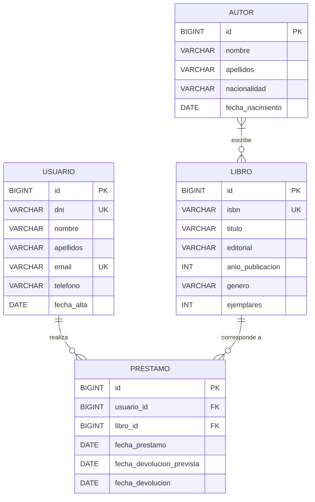

# Modelo de datos

Este documento es la referencia técnica del modelo. El diagrama E/R formal de la entrega (notación de Chen, hecho en
Lucidchart: `docs/diagramas/er.png`) y el modelo relacional obtenido por ingeniería inversa con MySQL Workbench
(`docs/diagramas/relacional.png` y el modelo editable `relacional.mwb`) coinciden con lo que aquí se describe.

## Diagrama E/R

## Relaciones

| Relación | Cardinalidad | En la base de datos | En JPA |
|---|---|---|---|
| Autor **escribe** Libro | **N:M** (un libro tiene uno o varios autores; un autor, varios libros) | Tabla intermedia `libro_autor` | `Libro.autores` `@ManyToMany` + `@JoinTable` (lado propietario) · `Autor.libros` `@ManyToMany(mappedBy)` |
| Usuario **realiza** Préstamo | 1:N | `prestamo.usuario_id` | `Prestamo.usuario` `@ManyToOne` · `Usuario.prestamos` `@OneToMany(mappedBy)` |
| Préstamo **corresponde a** Libro | 1:N | `prestamo.libro_id` | `Prestamo.libro` `@ManyToOne` · `Libro.prestamos` `@OneToMany(mappedBy)` |

Visto desde el E/R, **Usuario–Libro también es N:M**: un usuario toma prestados muchos libros y un libro lo toman
prestado muchos usuarios a lo largo del tiempo. Como esa relación tiene atributos propios (las fechas), se
convierte en la entidad `Prestamo`. Así el modelo tiene dos N:M: una "pura" (`libro_autor`) y otra con atributos (`prestamo`).

## Modelo relacional

- **autor** (<u>id</u>, nombre, apellidos, nacionalidad, fecha_nacimiento)
- **libro** (<u>id</u>, isbn *UK*, titulo, editorial, anio_publicacion, genero, ejemplares)
- **libro_autor** (<u>libro_id</u> → libro, <u>autor_id</u> → autor)
- **usuario** (<u>id</u>, dni *UK*, nombre, apellidos, email *UK*, telefono, fecha_alta)
- **prestamo** (<u>id</u>, usuario_id → usuario, libro_id → libro, fecha_prestamo, fecha_devolucion_prevista, fecha_devolucion)

El script completo está en [`src/main/resources/db/01-esquema.sql`](../src/main/resources/db/01-esquema.sql)
y los datos de prueba en [`02-datos.sql`](../src/main/resources/db/02-datos.sql).

## Reglas y decisiones

- **Estado del préstamo** (`ACTIVO`, `VENCIDO`, `DEVUELTO`): no se guarda, se calcula con `Prestamo.getEstado()` a partir de las fechas. Así nunca queda desactualizado.
  - `fecha_devolucion` con valor → **devuelto**
  - sin devolver y hoy > `fecha_devolucion_prevista` → **vencido**
  - sin devolver y dentro de plazo → **activo**
- **Plazo por defecto**: 15 días (`Prestamo.DIAS_PRESTAMO`).
- **Ejemplares**: un libro puede tener varias copias. Los disponibles son `ejemplares − préstamos sin devolver`
  (`PrestamoRepository.countByLibroIdAndFechaDevolucionIsNull`).
- **Borrados**: no se puede borrar un libro ni un usuario con préstamos (`ON DELETE RESTRICT`); hay que comprobarlo
  en el servicio (`existsByLibroId` / `existsByUsuarioId`) y mostrar un mensaje. Al borrar un libro o un autor, sus filas
  de `libro_autor` se borran solas (`ON DELETE CASCADE`).
- **Restricciones**: ISBN, DNI y email únicos; `ejemplares ≥ 1`; las fechas de devolución no pueden ser anteriores a la de préstamo.

## Cómo cambiar el modelo

Hibernate está en modo `validate`: **no crea ni modifica tablas**, solo comprueba que las entidades coinciden con ellas.
Para añadir o cambiar una columna:

1. Modificar `01-esquema.sql` (y `02-datos.sql` si hace falta).
2. Modificar la entidad Java.
3. Actualizar este documento y avisar al equipo (el diagrama E/R también cambia).
4. `./mvnw verify` → los tests ejecutan los scripts en H2 y validan las entidades.
5. Recrear la base de datos de Docker: `docker compose down -v && docker compose up -d`.
